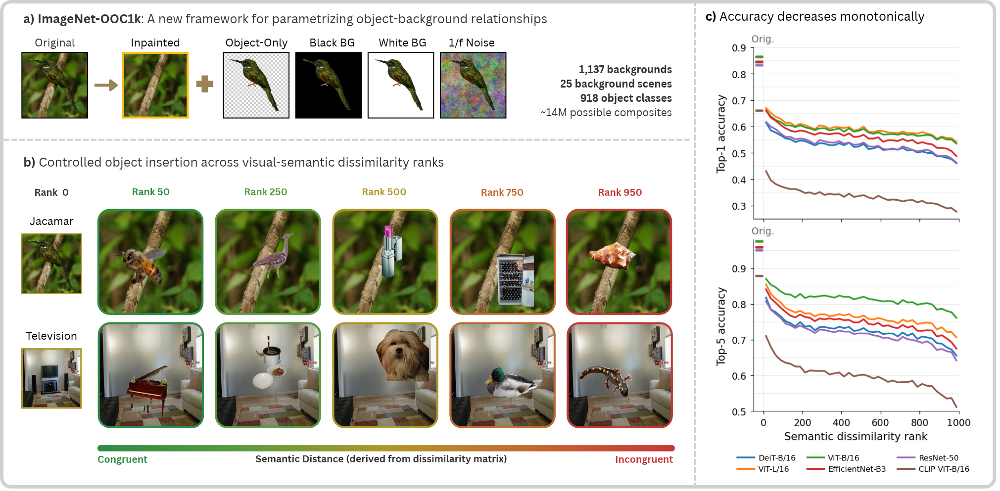

# How Far Is Too Far?
## Object Recognition Declines Monotonically with Semantic Distance

Code and dataset resources for our **NeurIPS 2026 Spotlight paper** by [Domenic Bersch](https://toastydom.github.io/), Hai Van Tran, and [Gemma Roig, Goethe University Frankfurt](https://www.cvai.cs.uni-frankfurt.de/).

Vision models recognise objects partly through their surroundings. But how does recognition change as an object and its background become less related?

**ImageNet-OOC1k** lets us study this relationship across a graded range of object–background combinations. We separate objects from ImageNet images, inpaint their original backgrounds, and recombine them at different visual-semantic distances. A **consensus visual-semantic axis**, built from the classifier heads of ten ImageNet models, measures the relationship between classes.

We evaluate 35 models and examine their internal representations to understand how object and background evidence contribute to recognition.

<p align="center">
  
</p>

## Contents

- [Main findings](#main-findings)
- [Dataset](#dataset)
- [Getting started](#getting-started)
- [Running the notebooks](#running-the-notebooks)
- [Acknowledgements](#acknowledgements)
- [Other resources](#other-resources)
- [Citation](#citation)

## Main findings

- **Recognition declines as objects and backgrounds become less related.** Across all 35 evaluated models, top-1 accuracy drops by approximately 9–19 percentage points from the most related to the least related combinations.
- **Backgrounds carry structured class information.** With the target object removed, models still predict its class above chance. Their incorrect predictions also tend to fall within related semantic categories.
- **Vision Transformers can retain object evidence despite an incorrect prediction.** In these “found-but-lost” cases, patch-level predictions identify the object, but the final prediction selects another class. Spatial re-ranking recovers a substantial fraction of these errors, improving accuracy by 5.7 percentage points on the diagnostic subset.
- **The decline persists across additional axes and generation controls.** It also appears under discriminative axes built from independently pretrained representations and remains after accounting for measured placement, scale, background, cutout, and boundary properties.

## Dataset

ImageNet-OOC1k is derived from [ImageNet](https://image-net.org) validation images and [ImageNet-S](https://github.com/LUSSeg/ImageNet-S) segmentation masks.

| Component | Count | Description |
|---|--:|---|
| **Backgrounds** | **1,137** | ImageNet validation scenes with the object removed by inpainting |
| &emsp;Nature | 558 | 12 subcategories, e.g. field, tree, sea, river, sky, snow |
| &emsp;Human-related | 533 | 13 subcategories, e.g. road, table, wall, yard, inside a house |
| &emsp;Misc | 46 | Scenes that fit neither category |
| **Object library** | **12,321** | Object cut-outs with their ImageNet-S segmentation masks |
| &emsp;Object classes | 918 | ImageNet classes, 915 of them with at least four instances |
| **Composites** | **953,862** | Library objects placed on backgrounds along the semantic axis, used in the behavioural experiments |
| &emsp;Backgrounds used | 260 | 10 per subcategory (Misc counts as one), each combined with all object classes |
| &emsp;Possible pairings | ~14.0 M | All backgrounds × all objects, if you want to generate more |
| **Mechanistic subset** | **75,000** | Composites for the patch-level analysis of five Vision Transformers: 20 rank bins × 3 background categories × 1,250 |


We distribute metadata and reconstruction files rather than complete ImageNet-derived images. To recreate the dataset, you need the ImageNet validation images and ImageNet-S annotations. The steps below reconstruct the source images, after which the notebooks generate the composites and controls.

## Getting started

The generated dataset occupies approximately **100 GB**. Choose a location with enough space for the dataset, downloaded archives, and analysis outputs.

### 1. Install the environment

Clone the repository and create the Conda environment.

```bash
git clone https://github.com/ToastyDom/ImageNet-OOC1k.git
cd ImageNet-OOC1k
conda env create -f environment.yml
conda activate ooc1k
```

The environment includes Python 3.11, PyTorch 2.10, timm 1.0.26, and the repository's `ooc1k` package. Pretrained model weights are downloaded when the models are first loaded.

### 2. Download the source files

You need three archives:

| File | Size | Download | Reference |
|---|---|---|---|
| `ImageNet-OOC1k_source.zip` — our metadata, background patches and the semantic axes of the paper | 249 MB | [Google Drive](https://drive.google.com/file/d/1pjOMNrFXZB62B7Kou3RMPaRDSFKznwop/view?usp=sharing) | [Our paper](#citation) |
| `ILSVRC2012_img_val.tar` — ImageNet validation images | 6.3 GB | [ImageNet downloads](https://image-net.org/download-images) | [Russakovsky et al., IJCV 2015](https://arxiv.org/abs/1409.0575) |
| `ImageNetS919-5f7f58ae1003d21da9409a8576bf7680.zip` — ImageNet-S annotations | 61 MB | [Download ZIP](https://github.com/LUSSeg/ImageNet-S/releases/download/ImageNet-S/ImageNetS919-5f7f58ae1003d21da9409a8576bf7680.zip) | [Gao et al., TPAMI 2022](https://arxiv.org/abs/2106.03149) · [GitHub](https://github.com/LUSSeg/ImageNet-S) |

For ImageNet-S, you only need the annotation ZIP listed above. You do not need to install its toolbox or run its preparation scripts.

### 3. Reconstruct the source images

From the repository root, extract our source archive and run the reconstruction script. The archive unpacks into `ImageNet-OOC1k/source/`; the notebooks later add the generated images next to it in `ImageNet-OOC1k/generated/`. The ImageNet and ImageNet-S archives can remain compressed.

```bash
unzip /path/to/ImageNet-OOC1k_source.zip

python prepare_source.py \
    --imagenet-val /path/to/ILSVRC2012_img_val.tar \
    --imagenet-s /path/to/ImageNetS919-5f7f58ae1003d21da9409a8576bf7680.zip
```

Replace the paths with the locations of your downloaded archives.

The script extracts the 1,137 original images and 12,321 object-library images, builds their masks, and reconstructs the inpainted backgrounds. It verifies the reconstructed files against our checksums to ensure that they match the expected source dataset.

Already extracted directories are also supported.

### 4. Generate the dataset

Open the notebooks from the repository root using the `ooc1k` environment.

First, run **notebook 01** to construct the visual-semantic axes. Then run **notebook 02** to generate the composites, control images, and mechanistic subset. The composite images occupy approximately 86 GB.

> Rebuilt axes can differ from ours by floating-point rounding (around 0.000001), which occasionally swaps two nearly equidistant classes. To reproduce our composites exactly, set `USE_PAPER_AXIS = True` in notebook 02. It then uses the consensus matrix of the paper from `ImageNet-OOC1k/source/semantic_axes_paper/`. If you want all notebooks to use the matrices of the paper, copy them over the ones from notebook 01:
>
> ```bash
> cp -r ImageNet-OOC1k/source/semantic_axes_paper/. data/semantic_axes/
> ```

Continue with the remaining notebooks to run inference and reproduce the analyses described below.

> Notebook 08 additionally requires ImageNet **training** images to fit the linear probes. These are only needed if you want to rerun that analysis.

## Running the notebooks

The notebooks cover the full workflow, from axis construction and dataset generation to model evaluation and diagnostic analyses. Each notebook explains its purpose and settings. Figures are saved to `outputs/figures/`.

| Notebook | Purpose | Paper |
|---|---|---|
| `01_semantic_axes` | Construct the consensus visual-semantic axis, individual classifier-head axes, and CLIP-text and WordNet comparisons | §4, Appendix B |
| `02_dataset_generation` | Generate composites, object-only controls, and the mechanistic subset | §3, Appendix A |
| `03_model_inference` | Run the 35 evaluated models and save their predictions | Behavioral experiments |
| `04_object_background_controls` | Evaluate objects and backgrounds separately and analyse background-only predictions | §5.1, Appendix C.1 |
| `05_semantic_distance` | Measure accuracy across visual-semantic distance and compare individual backgrounds | §5.2, Appendices C.2–C.3 |
| `06_patch_extraction` | Extract patch-level predictions and characterise found-but-lost errors across five Vision Transformers | §6, Appendices D and F |
| `07_spatial_reranking` | Test recoverability using spatial re-ranking | §6.3, Appendices E and F |
| `08_visual_semantic_axes` | Test model overlap and compare independently constructed probe, retrieval, linguistic, and taxonomic axes | Appendix C.4 |
| `09_generation_artifacts` | Test whether measured generation properties explain the accuracy decline | Appendix A.2 |

### Compute requirements

The dataset occupies approximately **98 GB**. The reported model inference and mechanistic extraction runs took approximately **97 GPU-hours on one NVIDIA A100 with 80 GB memory**. Running only the six main models reduces the inference workload.

### Generating your own variants

Use `02_dataset_generation.ipynb` to follow the generation pipeline and create your own dataset variants. The notebook brings together composite generation, object-only controls, and sampling of the mechanistic subset.

The underlying composite-generation code is in `ooc1k/dataset_generation/composites.py`. To explore other placement, scaling, or blending procedures, adjust the corresponding settings or implementation, regenerate the composites through notebook 02, and rerun inference.

## Acknowledgements

This work was partly funded by the BMFTR neuroAI grant GROWUPAI, DFG project 5368 (Abstract REpresentations in Neural Architectures, ARENA), and DFG project 539642788, RO 6458/5-1 (Learning from the Environment Through the Eyes of Children, LEECHI). We gratefully acknowledge support from the Hessian Center for Artificial Intelligence and Goethe University (NHR Center NHR@SW) for providing the computing and data-processing resources needed for this work.

## Other resources

Our dataset and analyses build on the following resources:

- **[ImageNet](https://image-net.org)** provides the source images and class labels.
- **[ImageNet-S](https://github.com/LUSSeg/ImageNet-S)** provides the segmentation annotations used to construct the object masks.
- **[IOPaint](https://github.com/Sanster/IOPaint)** and the MAT model were used for background inpainting.
- **[timm](https://github.com/huggingface/pytorch-image-models)** provides pretrained vision models and inference utilities.
- **[OpenAI CLIP](https://github.com/openai/CLIP)** provides the image–text model used in our evaluations.

ImageNet-derived components remain subject to the source datasets' access and redistribution terms. Please also cite ImageNet and ImageNet-S when using their data, following the references linked in the download table.

The code license is provided in [LICENSE](LICENSE).

## Citation

If you use ImageNet-OOC1k or this code, please cite:

```bibtex
TBA
```